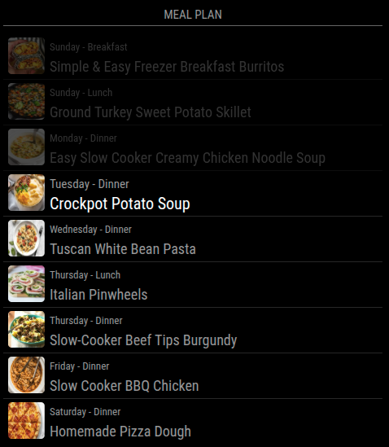

# MMM-MealieMenu ![Version][version-shield]

[![GitHub issues][issues-shield]](https://github.com/zanix/MMM-MealieMenu/issues)
[![GitHub pull requests][pull-requests-shield]](https://github.com/zanix/MMM-MealieMenu/pulls)
[![GitHub forks][forks-shield]](https://github.com/zanix/MMM-MealieMenu/network)
[![GitHub stars][stars-shield]](https://github.com/zanix/MMM-MealieMenu/stargazers)
[![License][license-shield]](https://github.com/zanix/MMM-MealieMenu/blob/master/LICENSE)

[![Build status][build-status-shield]](https://github.com/zanix/MMM-MealieMenu/actions/workflows/automated-tests.yaml)
[![Last commit][last-commit-shield]](https://github.com/zanix/MMM-MealieMenu/commits/main)
[![Commits][commits-shield]](https://github.com/zanix/MMM-MealieMenu/commits/main)

**A [MagicMirror²](https://github.com/MagicMirrorOrg/MagicMirror) module that displays your [Mealie][mealie-io-link] meal plan.**

## Description

This module shows your meal plan from [Mealie][mealie-io-link].

Mealie is an intuitive and easy to use recipe management app. It's designed to make your life easier by being the best recipes management experience on the web and providing you with an easy to use interface to manage your growing collection of recipes.

Mealie is self-hostable, meaning you can run it on your own server without any reliance on cloud-services.

## Table of Contents

- [Screenshots](#screenshots)
- [Requirements](#requirements)
- [Installation](#installation)
- [Update](#update)
- [API Key Generation](#api-key-generation)
- [Configuration](#configuration)
  - [Configuration Example](#configuration-example)
- [Translations](#translations)
- [Special Thanks](#special-thanks)
- [Contributing](#contributing)
  - [Code of Conduct](#code-of-conduct)
- [License](#license)
- [Changelog](#changelog)

## Screenshots

<!-- prettier-ignore-start -->

<!-- prettier-ignore-end -->

## Requirements

- MagicMirror² 2.22.0 or newer (`node_helper.js` relies on Node.js 18+ and its built-in `fetch`)
- A [Mealie][mealie-io-link] server.

## Installation

Just clone `MMM-MealieMenu` into the modules folder of your MagicMirror² installation:

```bash
cd ~/MagicMirror/modules
git clone https://github.com/zanix/MMM-MealieMenu
npm install --omit=dev
```

> [!TIP]
> You can use a specific version by checking out a tag or commit after cloning. For example, to use `v1.0.0`:
>
> ```bash
> git checkout v1.0.0
> ```

## Update

Go to the `MMM-MealieMenu` folder inside MagicMirror² modules folder and pull the latest version from GitHub:

```bash
cd ~/MagicMirror/modules/MMM-MealieMenu
git pull
npm install --omit=dev
```

Restart MagicMirror² after updating.

## API Key Generation

Mealie requires an API key for authentication. You can generate a key by going to your user profile in Mealie then to API Tokens link (or using this path `/user/profile/api-tokens`). You can also use your username and password for authentication, but using an API key is recommended.

## Configuration

<!-- prettier-ignore-start -->
<!-- markdownlint-disable MD033 MD060 -->
| Option                          | Description    |
|---------------------------------|----------------|
| `host`                          | <p>The URL to your Mealie instance.</p><p>**REQUIRED**<br>**Type:** `string`<br>**Example:** `"https://mealie.yourdomain.com"`<br>**Default value:** none</p>|
| `apiKey`                        | <p>An API key generated from a user profile in Mealie.</p><p>**REQUIRED** When not using username and password<br>**Type:** `string`<br>**Example:** `"eyhJbcG..."`<br>**Default value:** none</p><p>**Note:** You can generate a key by going to your user profile in Mealie then to API Tokens link (or using this path `/user/profile/api-tokens`).</p>|
| `username`                      | <p>The username/email for your Mealie account.</p><p>**REQUIRED** When not using `apiKey`<br>**Type:** `string`<br>**Example:** `"yourmeailieemail@email.com"`<br>**Default value:** none</p>|
| `password`                      | <p>The password for your for Mealie account.</p><p>**REQUIRED** When not using `apiKey`<br>**Type:** `string`<br>**Example:** `"Secret!"`<br>**Default value:** none</p>|
| `householdId`                   | <p>The Household ID (as a UUID) to use when fetching the meal plan.</p><p>**Type:** `string`<br>**Example:** `"41300275-fb6b-41eb-8b2b-e56f83e7b349"`<br>**Default value:** none ("Family" household)</p><p>**Note 1:** You can get the UUID of a household from Settings > Households.</p><p>**Note 2:** The default "Family" household is used when this is blank.</p><p>**Note 3:** For Mealie v1, Households do not exist, use Groups.|
| `groupId`                       | <p>The Group ID (as a UUID) to use when fetching the meal plan.</p><p>**Type:** `string`<br>**Example:** `"c0aa0c1c-bdbb-4948-823b-2a725fb05ce1"`<br>**Default value:** none ("Home" group)</p><p>**Note 1:** You can get the UUID of a group from Settings > Groups.</p><p>**Note 2:** The default "Home" group is used when this is blank.</p>|
| `currentWeek`                   | <p>Only show meals for the current week. Set to `true` to display meals up-to the end of the week. The beginning of the week is set using `weekStartsOnMonday`. The number of meals displayed is limited by `dayLimit`, `entryLimit`, `priorDayLimit`, and `priorEntryLimit`.</p><p>**Type:** `boolean`<br>**Default value:** `true`<br>**Possible values:** `true` and `false`|
| `weekStartsOnMonday`            | <p>Show Monday as the first day of the week. Set to `true` to show Monday as the first day of the week.</p><p>**Type:** `boolean`<br>**Default value:** `false`<br>**Possible values:** `true` and `false`</p><p>**Note:** Only valid when `currentWeek` is set to `true`.</p>|
| `dayLimit`                      | <p>How many days will be displayed after today.</p><p>**Type:** `integer`<br>**Example:** `5`<br>**Default value:** `7`<br>**Unit:** `days`</p><p>**Note:** If `0`, only today will be shown.</p><p>**Note 2:** If `currentWeek` is `true`, the max number of days is until the end of the week.|
| `priorDayLimit`                 | <p>How many previous days will be displayed. </p><p>**Type:** `integer`<br>**Example:** `5`<br>**Default value:** `7`<br>**Unit:** `days`</p><p>**Note 1:** If `0`, no previous days will be shown.</p><p>**Note 2:** If `currentWeek` is `true`, the max number of days is until the beginning of the week.</p>|
| `entryLimit`                    | <p>How many entries from future days should be shown in total.</p><p>**Type:** `integer`<br>**Example:** `25`<br>**Default value:** `50`<br>**Unit:** `meals`</p><p>**Note:** `dayLimit` takes precedence. For example, with `3` entries per day, `entryLimit` set to `5` and `dayLimit` set to `1`, you will only see `3` future entries.</p>|
| `priorEntryLimit`               | <p>How many entries from previous days should be shown in total. </p><p>**Type:** `integer`<br>**Example:** `25`<br>**Default value:** `50`<br>**Unit:** `meals`</p><p>**Note:** `priorDayLimit` takes precedence. For example, with `3` entries per day, `priorEntryLimit` set to `5` and `priorDayLimit` set to `1`, you will only see `3` prior entries.</p>|
| `fadePriorEntries`              | <p>Fade previous days in the current week.</p><p>**Type:** `boolean`<br>**Default value:** `true`<br>**Possible values:** `true` and `false`|
| `showPictures`                  | <p>Show pictures corresponding to that days meal.</p><p>**Type:** `boolean`<br>**Default value:** `true`<br>**Possible values:** `true` and `false`|
| `roundPictureCorners`           | <p>Round the meal picture corners.</p><p>**Type:** `boolean`<br>**Default value:** `false`<br>**Possible values:** `true` and `false`|
| `defaultPicture`                | <p>Picture to display for missing recipe images or meal notes.</p><p>**Type:** `string`<br>**Example:** `"https://img.icons8.com/nolan/64/meal.png"`<br>**Default value:** `"mealie.png"`</p><p>**Note:** If the image does not have `http` or `/` in the name, the `MMM-MealieMenu` module path will be prepended to the name.</p>|
| `groupByDay`                    | <p>Group meals under a heading for each day. The heading uses `dateFormat`, and each meal shows only its meal type (`dateMealSeperator` is not used).</p><p>**Type:** `boolean`<br>**Default value:** `false`<br>**Possible values:** `true` and `false`|
| `showDescription`               | <p>Show the recipe description or meal note.</p><p>**Type:** `boolean`<br>**Default value:** `false`<br>**Possible values:** `true` and `false`|
| `dateFormat`                    | <p>Display format for the date; uses [moment.js format string][moment-format-link]</p><p>**Type:** `string`<br>**Example:** `"ddd DD"`<br>**Default value:** `"dddd"`</p>|
| `dateMealSeperator`             | <p>Set the separator between the date and meal type.</p><p>**Type:** `string`<br>**Example:** `" \| "`<br>**Default value:** `" - "`</p><p>**Note:** Above each menu item, the date and meal type are displayed. For example, by default you'll see "Tuesday - Dinner". This setting controls the characters separating `dateFormat` and the meal display.</p>|
| `mealSortOrder`                 | <p>An array determining the order of the meal type headers.</p><p>**Type:** `array`<br>**Example:** `[ "lunch", "dinner" ]`<br>**Default value:** `[ "breakfast", "lunch", "dinner", "side" ]`<br>**Possible values:** `[ "breakfast", "lunch", "dinner", "side" ]`</p><p>**Note 1:** You can remove a meal type here by removing the value.</p><p>**Note 2:** The values MUST match the possible values above. You can change what is displayed using the `mealTypeName` options below.</p>|
| `mealTypeName`                  | <p>An object defining strings which are to be replaced in the displayed directions.</p><p>**Type:** `object`<br>**Example:** `{ "side": "Meal Prep", "dinner": "Supper" }`<br>**Default value:** `{}`</p><p>**Note:** The strings which appear as the keys of the object will be replaced by their values. Given a meal type `"side"` and the above mentioned example setting the displayed meal type will be `"Meal Prep"`.</p><p>**Note 2:** If you want to replace special symbols like `(`, `)` or `-` you must escape these characters by placing **two** back-slashes `\` in front of the character.</p>|
| `updateInterval`                | <p>The time in seconds when the meal plan should be updated.</p><p>**Type:** `integer`<br>**Example:** `300` (The meal plan will be refreshed every 5 minutes.)<br>**Default value:** `3600` (1 hour)<br>**Unit:** `seconds`</p>|
| `fontSize`                      | <p>Base font size of the module. All other sizes (`em`) scale from it, using MagicMirror's size classes</p><p>**Type:** `string`<br>**Possible values:** `"xsmall"`, `"small"`, `"medium"`, `"large"`, `"xlarge"`<br>**Default value:** `small`</p> |
| `animationSpeed`                | <p>Speed of the update animation.</p><p>**Type:** `integer`<br>**Possible values:** `0` - `5000`<br>**Default value:** `500`<br>**Unit:** `milliseconds`</p>|
| `displayLastUpdate`             | <p>Display the last update time at the end of the meal plan list.</p><p>**Type:** `boolean`<br>**Default value:** `true`<br>**Possible values:** `true` and `false`</p>|
| `displayLastUpdateFormat`       | <p>Format to use for the time display if `displayLastUpdate:true`; uses [moment.js format string][moment-format-link]</p><p>**Type:** `string`<br>**Example:** `'HH:mm:ss'`<br>**Default value:** `'MMM D - h:mm:ss a'`|
<!-- markdownlint-enable MD033 MD060 -->
<!-- prettier-ignore-end -->

### Configuration Example

Here is an example of an entry in `config.js`. Take note of `mealTypeName` and `mealSortOrder`. Here, we use the `side` meal type as a reminder of things we need to do to prepare for future meals, e.g., thaw meat. `mealTypeName` changes what appears, and `mealSortOrder` moves the side entries to the top of the list for each day.

```javascript
{
    module: "MMM-MealieMenu",
    header: "Dinner Menu",
    position: "top_left",
    config: {
        apiKey: "eyhJbcG...",                  // Not needed when using username/password
        username: "yourmealieemail@email.com", // Not needed when using apiKey
        password: "Secret!",                   // Not needed when using apiKey
        weekStartsOnMonday: true,
        roundPictureCorners: true,
        mealSortOrder: ["side", "breakfast", "lunch", "dinner"],
        mealTypeName: {
            side: "Meal Prep"
        }
    }
},
```

## Translations

UI text lives in `translations/en.json` and follows MagicMirror's `language` setting, falling back to English. To add a language, copy `en.json` to `translations/<lang>.json`, translate the values, and register it in the `getTranslations()` function in `MMM-MealieMenu.js`.

## Special Thanks

- [Michael Teeuw](https://github.com/MichMich) for creating the project [MagicMirror²](https://github.com/MagicMirrorOrg/MagicMirror). You can sponsor the MagicMirror² project on their [donate](https://magicmirror.builders/#donate) page.
- [KristjanESPERANTO](https://github.com/KristjanESPERANTO) for a great module standards example with [MMM-PublicTransportHafas](https://github.com/KristjanESPERANTO/MMM-PublicTransportHafas) and of course for the [3rd Party Modules](https://modules.magicmirror.builders) site.
- [Kael Spencer](https://github.com/kaelspencer) for creating the [MMM-PaprikaMenu](https://github.com/kaelspencer/MMM-PaprikaMenu) module, on which this one is originally based.
- [Brian O'Connor](https://github.com/btoconnor) for contributing to this project.

## Contributing

If you find any problems, bugs or have questions, please [open a GitHub issue](https://github.com/zanix/MMM-MealieMenu/issues) in this repository.

Pull requests are of course very welcome. Please see [Contributing](.github/CONTRIBUTING.md) and the [Pull Request Template](.github/PULL_REQUEST_TEMPLATE.md) for details.

### Code of Conduct

Please note that this project is released with a [Contributor Code of Conduct](CODE_OF_CONDUCT.md). By participating in this project you agree to abide by its terms.

## License

This project is licensed under the MIT License - see the [LICENSE](LICENSE) file for details.

## Changelog

All notable changes to this project will be documented in the [CHANGELOG.md](CHANGELOG.md) file.

[mealie-io-link]: https://mealie.io
[moment-format-link]: https://momentjs.com/docs/#/displaying/format/
[version-shield]: https://img.shields.io/github/package-json/v/zanix/mmm-mealiemenu?style=flat-square
[issues-shield]: https://img.shields.io/github/issues/zanix/mmm-mealiemenu?style=flat-square
[pull-requests-shield]: https://img.shields.io/github/issues-pr/zanix/mmm-mealiemenu?style=flat-square
[forks-shield]: https://img.shields.io/github/forks/zanix/mmm-mealiemenu?style=flat-square
[stars-shield]: https://img.shields.io/github/stars/zanix/mmm-mealiemenu?style=flat-square
[license-shield]: https://img.shields.io/github/license/zanix/mmm-mealiemenu?style=flat-square
[build-status-shield]: https://img.shields.io/github/actions/workflow/status/zanix/mmm-mealiemenu/automated-tests.yaml?branch=main&style=flat-square&logo=github-actions&logoColor=838B95
[last-commit-shield]: https://img.shields.io/github/last-commit/zanix/mmm-mealiemenu/main?style=flat-square&logo=github&logoColor=838B95
[commits-shield]: https://img.shields.io/github/commit-activity/m/zanix/mmm-mealiemenu/main?style=flat-square&logo=github&logoColor=838B95
